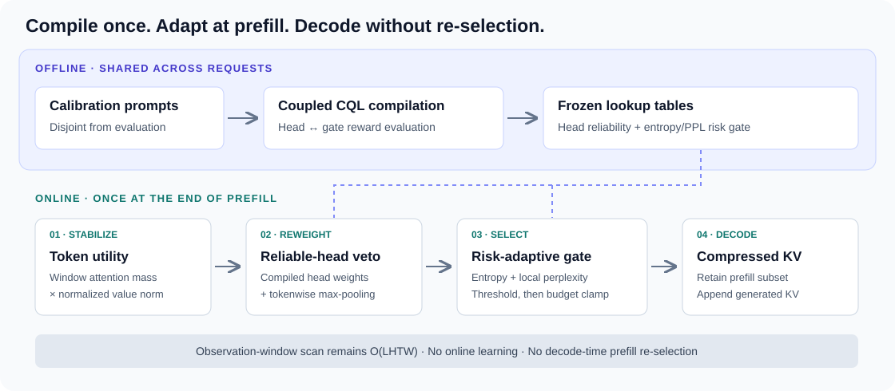

<div align="center">

# CompilerKV
### Risk-Adaptive KV Cache Compression via Offline Experience Compilation

**Accepted at NeurIPS 2026**

Ning Yang · Chengzhi Wang · Yibo Liu · Baoliang Tian · Haijun Zhang

[](https://arxiv.org/abs/2602.08686)
[](https://arxiv.org/abs/2602.08686)

**[Paper](https://arxiv.org/abs/2602.08686) · [Results](#paper-results) · [Quick start](#installation) · [Calibration](CompilerKV_v1/docs/calibration.md) · [Citation](#citation)**

</div>

> **TL;DR:** Compile reliable head priors and prompt-risk thresholds offline,
> then compress the prefill KV cache once. No online learning or decode-time
> re-selection of the retained prefill subset.

## News

- **NeurIPS 2026:** CompilerKV has been accepted! Read the [paper](https://arxiv.org/abs/2602.08686).

## Why CompilerKV?

| Better quality at a fixed budget | Less prefill KV memory | Lightweight deployment |
|:---:|:---:|:---:|
| **+1.67** LongBench points | **98.44%** KV reduction | **2.45×** decoding throughput |
| Mean gain over the best compressed baseline across four backbones, budget 512 | 32k prompt → 512 prefill entries | vs. FullKV at 32k on one A100-80GB |

Paper-reported results; full settings and comparisons are below.

## Method



1. **Stabilize token utility:** combine observation-window attention with normalized value norms.
2. **Inject head reliability:** use compiled head weights and max-pooling to preserve strong retrieval signals.
3. **Adapt to prompt risk:** look up a threshold using attention entropy and local perplexity, then clamp candidates to the token budget.

The retained prefill subset is fixed during decoding; newly generated KV states
are appended normally. The shared attention scan remains O(LHTW). The compact
table lookups, rather than the entire compressor, have constant-time overhead.

## Paper results

**Results are from the NeurIPS 2026 camera-ready manuscript.** Section/table
references identify their source. Accuracy gains are score points, not relative
percentage improvements. FullKV is the uncompressed reference, not a compressed
baseline.

### LongBench: four backbones, 512-token budget

Table 1 reports the macro-average of standard metrics across **16 LongBench
tasks**, using a **512-token prefill KV budget** for compressed methods. The
observation window is **64 query positions**. Offline calibration uses about
**50K prompts disjoint from evaluation**, with **128-token continuations** for
reward evaluation.

| Method | InternLM-2.5-7B-Chat-1M | LLaMA-3-8B-Instruct | Qwen2-7B-Instruct | Mistral-7B-Instruct-v0.2 |
|---|---:|---:|---:|---:|
| FullKV (reference) | 43.21 | 41.95 | 40.71 | 42.71 |
| SnapKV | 37.85 | 40.28 | 38.47 | 40.71 |
| PyramidKV | 37.86 | 40.19 | 38.19 | 40.47 |
| DynamicKV | 38.54 | 40.69 | 39.16 | 40.88 |
| AdaKV | 39.05 | 41.43 | 39.55 | 41.55 |
| HeadKV | 38.90 | 41.59 | 39.46 | 41.70 |
| CAKE | 39.12 | 41.83 | 39.73 | 41.80 |
| ChunkKV | 39.22 | 41.60 | 39.66 | 41.42 |
| **CompilerKV** | **42.61** | **42.55** | **41.13** | **42.94** |
| Gain over best compressed baseline, from displayed scores | +3.39 | +0.72 | +1.40 | +1.14 |

The paper reports a mean gain of **+1.67 points**, with task-bootstrap 95% CI
**[+1.08, +2.37]**. Gains in the table use the displayed rounded scores.
Across backbones, the reported mean is
**42.31 vs. FullKV 42.14**. This slight excess is budget-dependent, not a claim
that compression always improves accuracy: at a 128-token budget CompilerKV
remains the strongest compressed method in the paper but falls below FullKV.

<details>
<summary><b>More results: long-context retrieval, efficiency, ablations, Qwen3, and compilation cost</b></summary>

### Longer contexts and tighter memory

| Experiment | Setting | Paper-reported result | Source |
|---|---|---|---|
| RULER length scaling | Fixed retention ratio 512/32k; budgets 256/512/1024/2048 at 16k/32k/64k/128k | At 128k: CompilerKV ≈73, FullKV ≈79, SnapKV ≈38, KVZip ≈66.5 | §5.2, Appendix C |
| Needle-in-a-Haystack | 32k context | CompilerKV 0.89 vs. SnapKV 0.42 | §5.2, Appendix C |
| Cross-model table transfer | Direct source-to-target table transfer | Average loss of 0.4–0.8 LongBench points vs. target-model compilation | Appendix C.4 |

The RULER length sweep uses a **constant ratio**, not a constant 512-token budget
at every context length. Approximate figure values are marked with ≈.

### Efficiency

Single **A100-80GB**, 512-token prefill budget (§5.2 and Appendix C.5):

| Input context | Prefill KV reduction | Decoding throughput vs. FullKV |
|---|---:|---:|
| 8k | 93.75% | 1.31× |
| 16k | 96.88% | 1.78× |
| 32k | 98.44% | 2.45× |

These percentages describe **prefill KV entries**, not total GPU-memory savings
or an end-to-end latency speedup. Model weights and newly generated KV states
still consume memory. At 32k input plus 8k output, the paper reports batch-16
serving with CompilerKV while FullKV is OOM beyond batch 8. The paper's SGLang
configuration disables Radix Cache, chunked prefill, and CUDA Graph; this serving
integration is not included in the current release.

### Ablation: each component matters

LongBench averages at 512 tokens (Table 2):

| Variant | Mistral-7B | LLaMA-3-8B | Qwen2-7B | InternLM-2.5 |
|---|---:|---:|---:|---:|
| **CompilerKV** | **42.94** | **42.55** | **41.13** | **42.61** |
| Without stabilized utility | 40.20 | 39.84 | 38.61 | 38.09 |
| Without head reliability | 40.76 | 40.31 | 39.58 | 39.07 |
| Without risk-adaptive threshold | 38.97 | 38.52 | 37.73 | 37.24 |
| Offline reward regression (CQL weight = 0) | 42.18 | 41.88 | 40.54 | 41.76 |
| Independent head → gate compilation | 42.02 | 41.63 | 40.28 | 41.61 |

### Additional backbone: Qwen3-8B

Table 4 reports the following LongBench averages (FullKV: **49.46**):

| Prefill budget | Strongest compressed baseline | CompilerKV | Gain |
|---|---:|---:|---:|
| 128 | 47.46 | **48.32** | +0.86 |
| 512 | 48.93 | **49.67** | +0.74 |
| 1024 | 49.04 | **49.84** | +0.80 |
| 2048 | 49.33 | **49.91** | +0.58 |

These are paper results. A Qwen3-specific adapter is not provided in this release.

### One-time compilation cost

Table 3 reports GPU-hours; the 8B setting is LLaMA-3-8B on A100-80GB:

| Stage | 8B | 72B |
|---|---:|---:|
| Shared statistics | 15 | 126 |
| Head + gate reward generation | 4.5 | 40 |
| Head + gate fitting | 0.7 | ≈3 |
| Total | ≈20 | ≈169 |

The inexpensive table fit does **not** replace the model rollouts needed to
collect valid calibration experience. The paper reports deployed tables below
100 KB for 32 layers and below 1 MB at 72B scale.

</details>

## Installation

Requires Python **3.9+**. The tensor API and compiler need PyTorch and NumPy;
CPU is sufficient for unit tests and the small compiler smoke test.

```bash
git clone https://github.com/Chengzhi-W/CompilerKV.git
cd CompilerKV/CompilerKV_v1
python -m venv .venv
source .venv/bin/activate
python -m pip install --upgrade pip
# For GPU work, install the PyTorch build matching your CUDA environment first.
python -m pip install -e '.[test]'
python -m pytest
```

For LongBench/model integration, additionally install:

```bash
python -m pip install -r requirements.txt
# Linux + compatible CUDA/PyTorch toolchain; needed by the provided FA2 runner:
python -m pip install flash-attn --no-build-isolation
```

The adapters target **Transformers >=4.44,<4.46**. They patch model internals, so
newer Transformers versions are not assumed compatible. GPU/FlashAttention2
integration should be validated on the chosen checkpoint before benchmark runs.
Review custom model code before using checkpoints that require `trust_remote_code`.

## Quick start

Run the commands below from `CompilerKV_v1/` after installation.

### 1. Smoke-test the offline compiler

```bash
compilerkv-compile tables/calibration_record.example.jsonl \
  /tmp/compilerkv-smoke --num-layers 1 --num-heads 1 \
  --entropy-bins 2 --ppl-bins 2 --epochs 2 --device cpu
```

This writes `W_head.npy`, `T_gate.npy`, and `manifest.json`. It checks the data
path only. **Do not use these two example records as calibrated benchmark tables.**
For real calibration, follow the [coupled rollout protocol](CompilerKV_v1/docs/calibration.md)
and [artifact guide](CompilerKV_v1/tables/README.md).

### 2. Compress collected prefill tensors

```python
from kv_compression import CompilerKVCompressor

compressor = CompilerKVCompressor("/path/to/real/compiled-tables", observation_window=64)
output = compressor.compress(
    attention=attention,          # [layers, batch, heads, queries, tokens]
    key_cache=key_cache,          # [layers, batch, kv_heads, tokens, head_dim]
    value_cache=value_cache,      # same layout as key_cache
    token_logprobs=token_logprobs,  # [batch, queries], for local perplexity
    budgets=512,
)
```

The variables above are tensors collected from your model, not synthetic
calibration artifacts. Attention may contain only the final observation-window
rows. You may instead pass measured `local_ppl` (scalar or one value per sample).
Missing semantic-risk input is an error by default. Returned per-layer/per-sample
caches are ragged because retention can fall below budget; for batch size one,
use `output.dense_cache_for_batch_one()`.

A tensor-file wrapper is available in
[`examples/compilerkv_example.py`](CompilerKV_v1/examples/compilerkv_example.py).
Only load tensor files from trusted sources.

### 3. Run LongBench with real tables

```bash
export MODEL_PATH=/path/to/checkpoint
export MODEL_NAME=llama-3-8b-instruct
export TABLES_DIR=/absolute/path/to/compiled-tables
export PROMPT_PPL_FILE=/absolute/path/to/prompt_ppl.json
bash run_compilerkv_full.sh

python run/longbench/eval.py \
  --results_dir /path/to/prediction-output --method compilerkv
```

`PROMPT_PPL_FILE` is a JSON mapping from each LongBench `_id` to its measured
observation-window perplexity. Use the same checkpoint, prompt formatting, and
observation window as prediction. A single constant `PROMPT_PPL` is supported by
the runner for diagnostics but is not a replacement for per-prompt semantic risk.
The runner defaults to budget 512, observation window 64, batch size 1, and
FlashAttention2. Keep calibration and evaluation examples disjoint.

## Code and artifacts

The release contains a tensor-level compressor, a horizon-one CQL table compiler,
LongBench prediction/evaluation scripts, model adapters for LLaMA/Mistral/Qwen2/
InternLM, and CPU unit tests. Existing LongBench data and result snapshots are
included under `data/` and `results/`.

To run a model, supply its checkpoint, compiled `W_head` / `T_gate` tables, and
prompt-level semantic-risk measurements. The compiler consumes collected
calibration records; see the [calibration guide](CompilerKV_v1/docs/calibration.md)
for the coupled rollout protocol. `tables/compiled/` is the output destination;
pretrained table artifacts are not bundled. The example JSONL is for a quick
smoke test, not model calibration.

The SGLang serving integration, Qwen3 adapter, and full RULER/NIAH experiment
runners discussed in the paper are not part of this release. CPU tests cover the
reference operator and compiler; GPU benchmark results above come from the paper.

## Repository layout

```text
CompilerKV_v1/
├── kv_compression/
│   ├── core.py             # Canonical tensor operator and artifact validation
│   ├── api.py              # Public compressor API
│   ├── compiler/           # Calibration records and horizon-one CQL fit
│   └── token_drop/         # Model adapters and legacy DynamicKV code
├── docs/calibration.md     # Data collection / coupled reward protocol
├── examples/               # Tensor-level invocation
├── tables/                 # Example schema and compiled-artifact destination
├── run/longbench/          # Prediction, metrics, and evaluation
├── tests/                  # CPU operator, compiler, and validation tests
├── data/LongBench/          # Existing benchmark data snapshot
└── results/                # Existing experiment snapshots
```

## Citation

If CompilerKV supports your research, please cite our NeurIPS 2026 paper.

```bibtex
@inproceedings{yang2026compilerkv,
  title     = {{CompilerKV}: Risk-Adaptive {KV} Cache Compression via Offline Experience Compilation},
  author    = {Yang, Ning and Wang, Chengzhi and Liu, Yibo and Tian, Baoliang and Zhang, Haijun},
  booktitle = {Advances in Neural Information Processing Systems},
  year      = {2026},
  url       = {https://arxiv.org/abs/2602.08686}
}
```

## Acknowledgments

CompilerKV builds on research in prefill KV compression, including SnapKV,
PyramidKV, DynamicKV, AdaKV, HeadKV, CAKE, and ChunkKV, and evaluates with
LongBench and RULER. Existing code attribution is preserved. Model checkpoints
and datasets remain subject to their respective licenses and access conditions.
